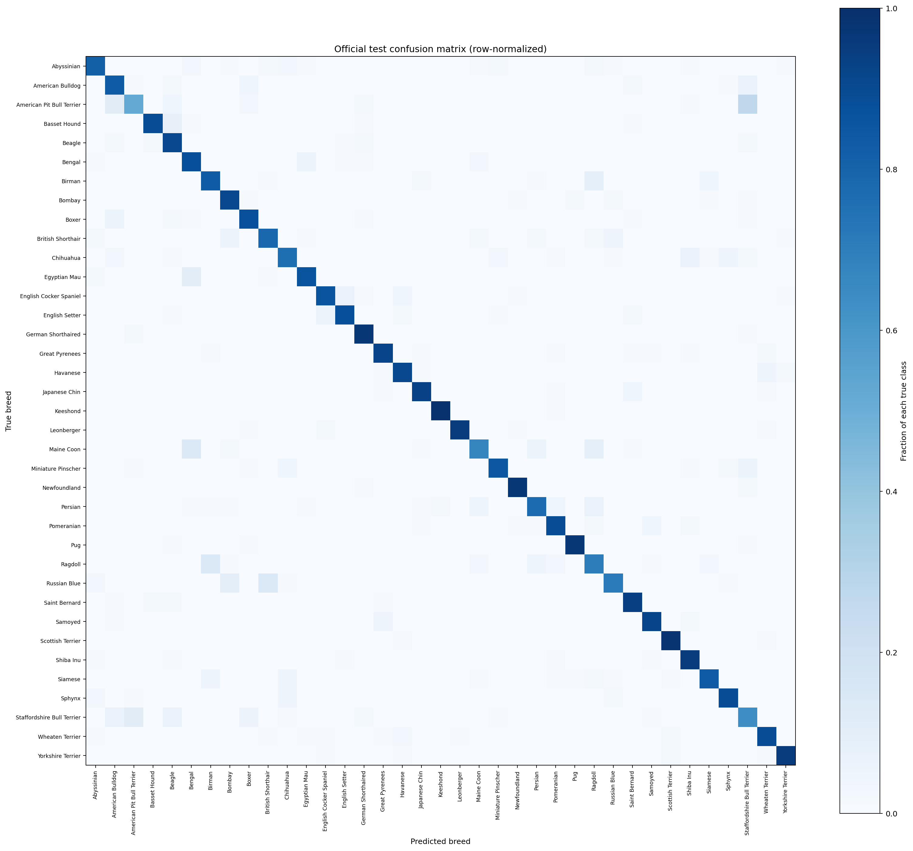

# PetBreed AI - measured technical report

## Project scope

Classify one cat or dog photograph into one of 37 Oxford-IIIT Pet breeds. The system performs image classification only: it does not locate or segment animals and has no rejection class for unfamiliar breeds or non-pet images.

## Dataset and preprocessing

The run used the official Oxford-IIIT Pet `trainval` split with a stratified 80/20 split and seed 42: 2,944 training and 736 validation images. The official test set contains 3,669 images. Training ran on Colab CUDA; input-size latency and the final held-out test were measured on the Colab CPU. Colab CPU timing is not a prediction of local CPU speed.

Training augmentation used random resized crop and horizontal flip. Validation and test used deterministic resize and center crop. All images were normalized with ImageNet mean and standard deviation.

## Model and training results

The model is ImageNet-pretrained MobileNetV3-Small with a 37-class output layer. The run used three head-only epochs followed by three fine-tuning epochs. The first stage froze the pretrained feature extractor and trained the new classifier. The second stage unfroze the last two feature blocks and trained them at a lower learning rate. The checkpoint was selected by validation macro-F1.

| Training stage | Best epoch | Validation loss | Validation accuracy | Validation macro-F1 |
| --- | ---: | ---: | ---: | ---: |
| Head-only | 3 | 0.40071 | 0.85870 | 0.85897 |
| Fine-tuning | 3 | 0.36622 | 0.88859 | 0.88945 |

Fine-tuning improved validation accuracy by 0.02989 and macro-F1 by 0.03047. The last feature blocks could adapt pretrained visual features to breed-level cues; the lower validation loss and higher validation metrics are consistent with that explanation. The independent test result below is lower than the best validation result, so the validation improvement should not be treated as a guarantee of equal performance on new images.

The checkpoint is 6.335 MB. `artifacts/run_metadata.json` preserves the Colab source commit and package/runtime versions. The original run folder was `/content/drive/MyDrive/PetBreedAI/runs/20261026_155151_utc`.

## Input-resolution comparison

The same checkpoint was compared on the validation split. The benchmark used 50 selected images, discarded five warm-up measurements, and reported the median of the remaining 45 per-image preprocessing-plus-forward-pass timings.

| Input size | Validation accuracy | Validation macro-F1 | Median Colab CPU latency |
| --- | ---: | ---: | ---: |
| 224px | 0.88859 | 0.88945 | 11.04 ms |
| 160px | 0.82065 | 0.82142 | 8.87 ms |

At 160px, latency fell by 2.17 ms (19.7%), but accuracy fell by 0.06793 and macro-F1 by 0.06803. The selection rule permits a macro-F1 decrease of at most 0.02, so the faster 160px setting was rejected. The final configuration uses **224px**. This was input-resolution optimization; no pruning or quantization was performed.

## Final held-out test

The selected 224px configuration was evaluated once on the official test split, after validation-based selection:

- Accuracy: **0.86018**
- Macro-F1: **0.85872**
- Images: **3,669**
- Correct predictions from the saved confusion matrix: **3,156**
- Misclassifications: **513**

The row-normalized confusion matrix is saved at [`artifacts/confusion_matrix.png`](artifacts/confusion_matrix.png); raw counts are in `artifacts/confusion_matrix.npy`. The largest directed confusion in the matrix is American Pit Bull Terrier predicted as Staffordshire Bull Terrier (27 images). This is an aggregate class-level count, not an additional hand-picked image example.

## Visual review of five saved mistakes

These are the first five entries in the saved `errors_sample`, ordered by test index. All five have true label Abyssinian. They are a small, one-class slice of the mistakes and are **not representative of all model errors**. The `observed` column describes the image; the final column contains tentative explanations, not verified causes.

| Test index | True label -> prediction | Observed in the image | Possible explanation (hypothesis only) |
| ---: | --- | --- | --- |
| 0 | Abyssinian -> Chihuahua | Full cat in side view on a table in a dim indoor room with many background objects. | Low light and clutter may weaken useful shape and texture cues. The image still visibly shows a cat, so this miss cannot be explained confidently from the photo alone. |
| 2 | Abyssinian -> Miniature Pinscher | Full-body, front-facing brown cat standing on indoor steps, with upright ears and railings behind it. | The upright pose, slender outline, and warm coat may overlap features the model learned for a small dog breed; the railings add background structure. This is only a plausible explanation. |
| 4 | Abyssinian -> Bombay | Tight gray-brown face crop with large ears against a very bright background; little of the body is visible. | The crop removes body and coat-pattern context, and the bright background changes contrast. The visual evidence does not establish why the model selected Bombay. |
| 10 | Abyssinian -> Yorkshire Terrier | Cat lying upside down on a carpet, with paws and belly visible and a busy indoor background. | The unusual orientation and pose may make the learned shape cues less reliable. The image alone cannot confirm the cause of the dog-class prediction. |
| 12 | Abyssinian -> Bengal | Close-up face in strong sunlight and shadow, with the body mostly cropped out and coat markings visible. | Coat markings may resemble patterns associated with Bengal, while harsh lighting and the close crop remove other cues. This remains a hypothesis. |

The five original images and montage remain in the local ignored `artifacts/` folder; they are not committed as dataset images. Their indices and labels are retained in `artifacts/eval_results.json`.

## Local demo verification

`app.py` loads `artifacts/best.pt` on CPU, applies the checkpoint's 224px transform, and displays the top three classes with softmax scores. The local Streamlit server returned HTTP 200 at its health and app endpoints. The real checkpoint loaded on CPU with 37 classes. The UI accepted each of the five genuine cat photographs above and rendered three prediction bars. This was an upload and inference smoke check only; it did not recompute test metrics or change the selected model. Invalid image data and a missing checkpoint produced clear UI errors.

## Limitations and future work

The model always chooses one of the 37 known breeds. It can give a confident-looking softmax score for unrelated images, unseen breeds, multiple pets, or poor photographs; the scores are not calibrated. The classifier does not localize or segment an animal. The five inspected errors all share one true breed and cannot describe the full error distribution.

Useful next steps include reviewing errors across all classes, measuring confidence calibration and open-set rejection, checking performance on personal photographs, and testing robustness to lighting, pose, and background changes. Any future model or preprocessing change should be selected on validation data and evaluated on a separate held-out test set.

## Reproduction and project files

The checkpoint, training history, evaluation JSON, confusion matrix, and runtime metadata are in `artifacts/`. The dataset and the five source test photos are not committed. The exact Colab run settings and final local commands are in `README.md`. The completed training and final test must not be rerun to use the demo.
